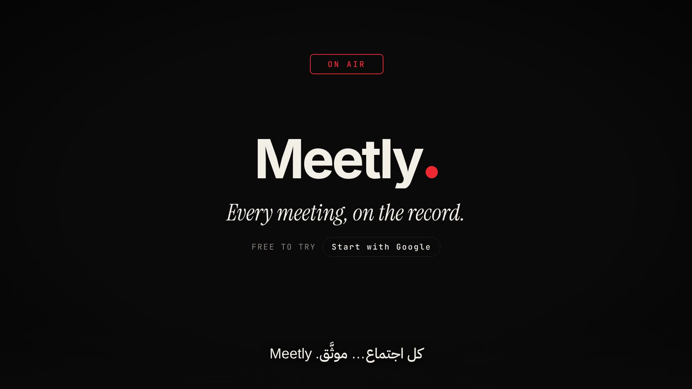
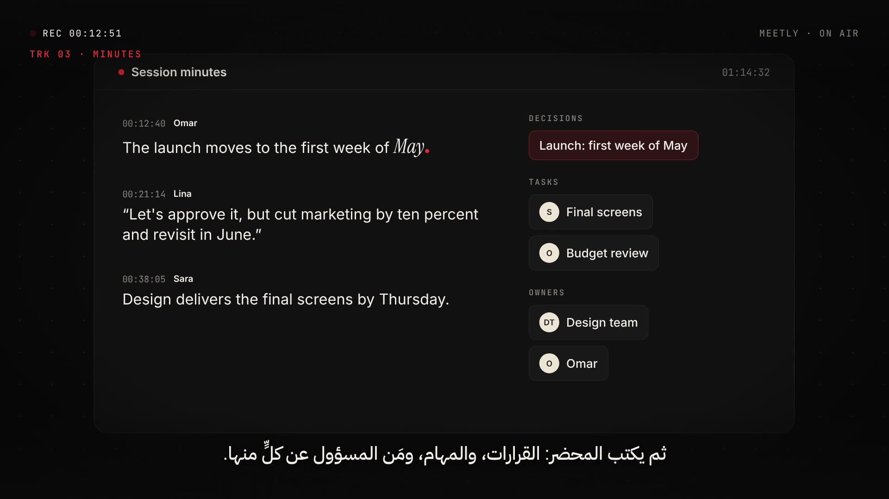
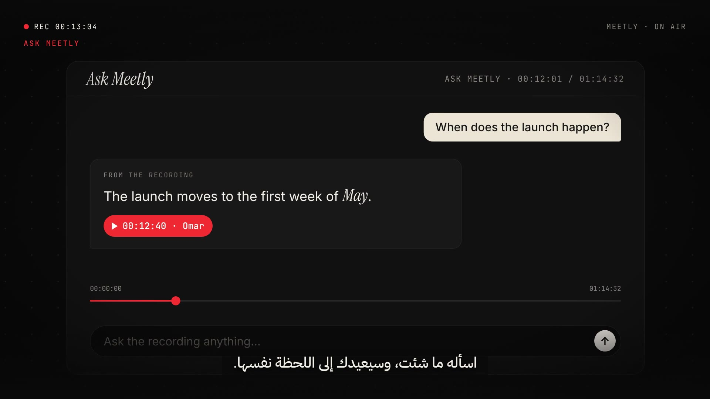

<div align="center">

# Meetly

**Every meeting, on the record.**

Upload a meeting recording. Meetly transcribes every word, writes the minutes,
emails a branded PDF to everyone invited, and lets you ask the recording anything.

### [🔴 Try the live demo](https://63-188-47-182.sslip.io/)



</div>

---

## What it does

| | |
|---|---|
| 🎙️ **Record** | Upload a recording from your laptop or a Google Drive link, and list who attended. |
| 📝 **Transcribe** | Every word, with who said it and the exact minute it was said. |
| ✅ **Minutes** | A summary, the decisions, tasks with owners, and what is still open. |
| 📩 **Master & send** | The minutes are rendered into a Meetly-branded PDF and emailed to every attendee. |
| 💬 **Ask Meetly** | Ask the recording a question. Answers come only from the meeting, with a cue to the minute it was said. |
| 📚 **Library** | Every meeting is kept in a personal archive you can reopen any time. |

The interface is fully bilingual (English / العربية), and recordings are deleted once the minutes are ready.



## How it works

```
Browser (Next.js)  ⇄  FastAPI backend  ⇄  Storage (local files or Firestore)
                           │
                           └─► Background worker
                                 recording ─► Gemini (transcript with speakers + timestamps)
                                           ─► GPT (minutes: decisions, tasks, owners)
                                           ─► WeasyPrint (branded PDF, Arabic + English)
                                           ─► SMTP (email to every attendee)
```



## Tech stack

- **Frontend:** Next.js 15, React 19, GSAP, Lenis, custom bilingual i18n
- **Backend:** Python, FastAPI, Uvicorn, Authlib (Google sign-in)
- **AI:** Google Gemini for transcription, OpenAI GPT for minutes and Q&A
- **Documents & email:** WeasyPrint PDF generation with embedded Arabic/Latin fonts, SMTP delivery
- **Infrastructure:** Docker, Caddy (automatic HTTPS), AWS EC2. Optional Google Cloud (Cloud Run, Firestore, Cloud Storage)

## Project structure

```
app/            FastAPI backend
  main.py       sign-in, API routes, serves the built site
  worker.py     background processing of each meeting
  ai.py         transcription, minutes and chat prompts
  pdf.py        branded PDF of the minutes
  mailer.py     email delivery to attendees
  store.py      meetings storage (local files or Firestore)
web/            Next.js frontend (landing, library, new meeting, chat, login)
aws/            Docker Compose + Caddy setup for AWS
docs/           screenshots and the full setup guide (Arabic)
```

## Run it locally

```bash
# 1. Backend
python -m venv venv && source venv/bin/activate
pip install -r requirements.txt

# 2. Frontend (builds the site into web/out)
cd web && npm install && npm run build && cd ..

# 3. Settings: create a .env file (never commit it)
#    GEMINI_API_KEY=...   OPENAI_API_KEY=...
#    DEV_LOGIN=1          (local testing without Google sign-in)

# 4. Start
uvicorn app.main:app --reload --port 8000
```

Then open http://localhost:8000. The full deployment guide (Colab, Google Cloud, AWS) is in [`docs/SETUP.ar.md`](docs/SETUP.ar.md).

## Status

Meetly is in its first public version. Feedback and ideas are welcome: open an issue.

---

<div align="center">
Designed, built and deployed by <b>Nujoom</b>.
</div>
